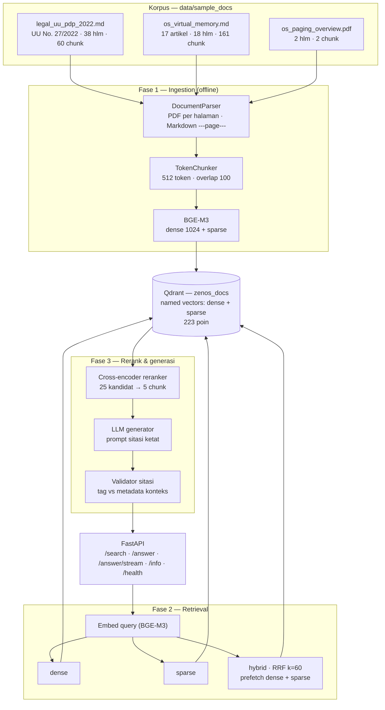
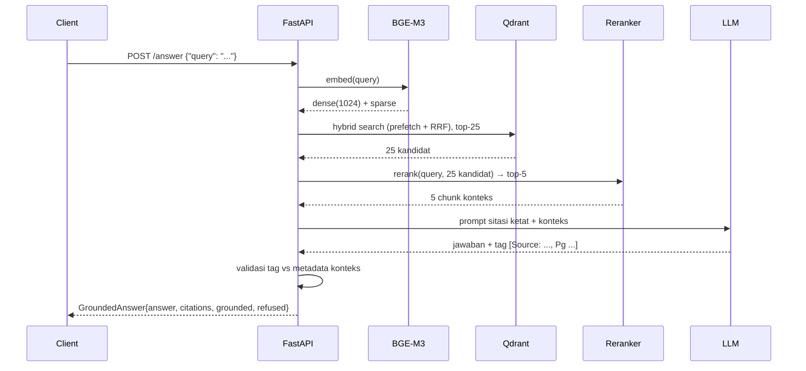
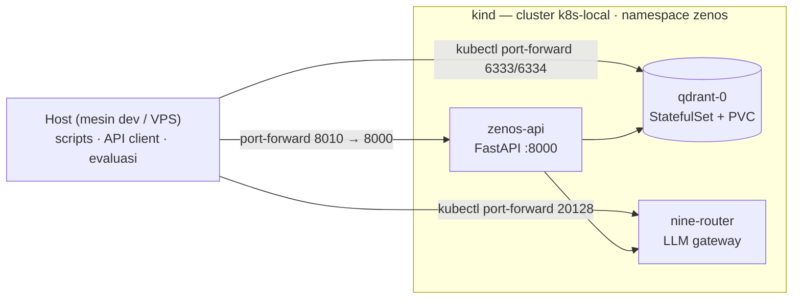

# Zenos — Hybrid RAG dengan Sitasi Terverifikasi

Zenos adalah sistem tanya-jawab *retrieval-augmented generation* (RAG) yang menjawab
**hanya** dari korpus yang diberikan, dan setiap kalimat deklaratifnya membawa sitasi
`[Source: <nama_file>, Pg <halaman>]` yang **diverifikasi secara programatik** terhadap
metadata chunk yang benar-benar dikirim ke LLM — bukan dipercaya begitu saja dari output
model.

Fokusnya bukan "LLM yang pintar", tapi **grounding yang bisa dibuktikan**: kalau buktinya
tidak ada di konteks, sistem harus menolak menjawab.

| | |
| --- | --- |
| Korpus | 3 dokumen · **223 chunk** · ~101k token |
| Embedding | `BAAI/bge-m3` — dense (1024) + sparse, satu model |
| Retrieval | dense · sparse · hybrid (RRF k=60 di Qdrant) |
| Reranker | cross-encoder `BAAI/bge-reranker-v2-m3` (25 → 5 chunk) |
| Generator | LLM via endpoint OpenAI-compatible, prompt sitasi ketat |
| Serving | FastAPI (6 endpoint, termasuk SSE), OpenAPI 3.1 |
| Deployment | Kubernetes (`kind`, namespace `zenos`), akses via port-forward |
| Tes | **117 passed** |
| Evaluasi terdokumentasi | 4 skenario retrieval (dense · sparse · hybrid ± reranker) + metrik generasi (groundedness, citation precision, refusal, TTFT) |

---

## 1. Masalah & pendekatan

RAG biasa punya satu kelemahan yang mahal: model bisa mengarang jawaban yang terdengar
benar. Zenos menyerang itu di dua tempat sekaligus:

1. **Kualitas retrieval.** Bukan hanya mirip secara makna (dense), tapi juga cocok secara
   istilah (sparse) — lalu digabung dengan *Reciprocal Rank Fusion*, lalu disaring oleh
   cross-encoder. Dua tahap penyaringan ini diukur terpisah supaya kontribusi masing-masing
   bisa dibuktikan, bukan diasumsikan.
2. **Verifikasi sitasi.** Setiap tag `[Source: ...]` dicocokkan ke metadata chunk yang
   dikirim ke model. Tag yang menunjuk sumber di luar konteks dihapus, dan jawaban kosong
   atau menolak ditandai eksplisit (`refused=True`) alih-alih lolos sebagai jawaban sah.

Korpusnya sengaja campur bahasa: satu dokumen hukum Indonesia (UU No. 27/2022 tentang
Pelindungan Data Pribadi) dan satu korpus teknis bahasa Inggris (virtual memory / paging).
Ini menguji sistem pada *query* Indonesia dan Inggris di atas koleksi yang sama.

---

## 2. Arsitektur



Dua tahap penyaringan itu — **fusion** (dense + sparse → RRF) dan **reranking**
(25 → 5) — masing-masing bisa dimatikan lewat konfigurasi, justru supaya kontribusinya bisa
diukur secara terpisah (`RETRIEVAL_MODE`, `RERANK_ENABLED`, atau flag di
`scripts/evaluate_scenarios.py`).

### Alur satu permintaan



`POST /answer/stream` menjalankan jalur yang sama tapi mengirim token sebagai SSE
(`text/event-stream`) beserta `ttft_ms` — inilah yang diukur untuk target latensi.

---

## 3. Komponen

| Lapisan | Modul | Isi |
| --- | --- | --- |
| Ingestion | `src/ingestion/` | `DocumentParser` (PDF per halaman, Markdown pada penanda `---page---`), `TokenChunker` (512 token, overlap 100, `cl100k_base`), `IngestionPipeline` |
| Embedding | `src/embeddings/bge_m3.py` | `BGE-M3` → dense 1024 (L2-normalized) + sparse terlatih, dalam satu inferensi |
| Penyimpanan | `src/db/qdrant.py` | `QdrantManager`: satu koleksi dengan named vector `dense` + `sparse`, `search_dense` / `search_sparse` / `search_hybrid_rrf` (prefetch + `Fusion.RRF`) |
| Retrieval | `src/retrieval/` | `rrf.py` (RRF murni Python, untuk tes silang), `llama_retrievers.py` (retriever dense/sparse/RRF sebagai `BaseRetriever` LlamaIndex), `metrics.py` (Recall@k, MRR) |
| Reranking | `src/reranking/reranker.py` | `LocalCrossEncoderReranker` (`bge-reranker-v2-m3`) & `CohereReranker`; `get_reranker()` memilih backend |
| Generasi | `src/generation/` | `GroundedQAPipeline` (retrieve → `select_context` → generate), `GroundedGenerator`, `prompts.py` (`CITATION_PATTERN`, deteksi penolakan) |
| API | `src/api/` | FastAPI: `/`, `/health`, `/info`, `/search`, `/answer`, `/answer/stream` |
| Evaluasi | `scripts/`, `data/eval/` | `evaluate_recall.py`, `evaluate_scenarios.py`, `benchmark_ttft.py`, `evaluate_ragas.py`, eval set berbasis *anchor* |
| Deployment | `deploy/k8s/` | `namespace`, `qdrant` (StatefulSet + PVC), `nine-router` (+ PVC terpisah), `api`, `kustomization` |

---

## 4. Stack & penyimpangan dari PRD

| Keputusan | PRD | Implementasi | Alasan |
| --- | --- | --- | --- |
| Vector DB | Qdrant | **Qdrant 1.13.4**, satu koleksi dua named vector | RRF bisa dijalankan di sisi DB |
| Embedding | `BAAI/bge-m3` | sama | dense + sparse dari satu model, multibahasa |
| Reranker | Cohere Rerank 3 | **lokal `bge-reranker-v2-m3`**; Cohere tetap tersedia (`RERANK_PROVIDER=cohere`) | bisa jalan tanpa API key; **catatan: terlalu lambat di CPU mesin ini, lihat §7** |
| LLM | Claude (Anthropic) | **`smp/claude-haiku-5-5`** via endpoint OpenAI-compatible (9router) | endpoint yang tersedia; kualitas vs Sonnet belum diuji |
| Orkestrasi | LlamaIndex | pipeline produksi memanggil `QdrantManager` langsung; wrapper LlamaIndex ada di `llama_retrievers.py` | metadata chunk (`doc_id`, `page_number`, `chunk_id`) tetap eksplisit untuk validasi sitasi |
| Serving | FastAPI | FastAPI + spesifikasi **OpenAPI 3.1** (`docs/openapi.yaml`) | bisa langsung diimpor ke Apidog/Postman |

---

## 5. Korpus

Dibangun ulang secara reproducible oleh `scripts/fetch_corpus.py` (satu perintah:
unduh → konversi → potong → lapor).

| Dokumen | Halaman | Chunk | Token | Sumber & lisensi |
| --- | --- | --- | --- | --- |
| `legal_uu_pdp_2022.md` | 38 | 60 | 22 165 | Teks lengkap UU No. 27/2022 (PDF → Markdown). Peraturan perundang-undangan **tidak berhak cipta** (UU No. 28/2014 Pasal 42) |
| `os_virtual_memory.md` | 18 | 161 | 78 780 | 17 artikel Wikipedia (virtual memory, paging, TLB, MMU, page fault, …) — **CC BY-SA 4.0**, atribusi tertanam di header file |
| `os_paging_overview.pdf` | 2 | 2 | 130 | PDF multi-halaman, untuk menguji sitasi per halaman |
| **Total** | **58** | **223** | **101 075** | |

Korpus sebelumnya hanya 6 chunk. Pada ukuran itu Recall@25 selalu 1,00 di semua mode,
sehingga metriknya tidak bisa membedakan apa pun — sekarang 25 dari 223 chunk (±11%), dan
Recall@25 tetap saturasi, tapi setidaknya Recall@5 punya ruang bergerak.

**Ground truth tidak men-*hardcode* `doc_id`.** `doc_id` adalah hash isi file, jadi id yang
dipatok akan basi begitu korpus disentuh — dan karena id basi hanya "tidak cocok", recall
ambruk ke 0 tanpa error apa pun (ini benar-benar terjadi di proyek ini). Sekarang tiap
pertanyaan menyimpan *anchor phrase* verbatim yang diresolusikan ke `chunk_id` saat runtime
(`data/eval/sample_corpus.py`); anchor yang hilang **melempar error**, bukan diam-diam
dinilai gagal. `tests/test_eval_set.py` menjaga agar korpus tidak menyusut dan tidak ada hash
`doc_id` yang kembali dipatok.

---

## 6. Deployment



Catatan operasional yang menentukan bentuk di atas:

* **hostPort tidak mungkin dipakai di mesin ini.** Kernel `7.2.11-zen1-1-zen` tidak punya
  modul `xt_multiport`, sehingga CNI portmap milik kind gagal
  (`Extension multiport revision 0 not supported`). Ini bukan soal konfigurasi.
* **IP node tidak boleh di-*hardcode*.** IP node kind berubah saat container di-restart
  (`172.20.0.2` → `172.20.0.3`). Port-forward adalah satu-satunya jalur akses yang stabil.
* **Port 8000 di host dipakai Portainer**, jadi API diakses di `8010` dari host; di dalam
  cluster tetap `8000`.
* **Qdrant (6333/6334) dan 9router (20128) tidak boleh diekspos publik.** API ini belum punya
  autentikasi.
* **CPU-only wajib** untuk image API: torch CUDA membengkakkan image jadi 10,8 GB; versi
  CPU 3,3 GB.
* **Cache model di-*seed* ke PVC** dengan `HF_HUB_OFFLINE=1` — unduhan HF di dalam pod macet,
  sementara di host selesai dalam ~2 detik.

---

## 7. Hasil evaluasi

Semua angka di bawah **diukur**, bukan diperkirakan. Data mentah tersimpan di `results/`.

### Baseline retrieval (tanpa reranker)

Sumber: [`results/phase2-recall.md`](results/phase2-recall.md)

| Mode | Recall@25 | Recall@5 |
| --- | --- | --- |
| dense | 1.000 | 0.625 |
| sparse | 1.000 | 0.625 |
| hybrid (RRF k=60) | 1.000 | **0.688** |

### Keempat skenario (hasil utama)

Sumber: [`results/scenarios-1-2.md`](results/scenarios-1-2.md) ·
[`results/scenarios-3-4.md`](results/scenarios-3-4.md) · data mentah:
`results/scenarios-{1-2,3,4}.json` dan `results/generation-{3,4}.json`

| Skenario | Mode | Reranker | Recall@25 | MRR@25 | **Recall@5** | MRR@5 | Retrieval ms | Rerank ms |
| --- | --- | --- | --- | --- | --- | --- | --- | --- |
| 1 | dense | ya | 1.000 | 0.535 | **0.812** | 0.692 | 2 815 | 67 914 |
| 2 | sparse | ya | 1.000 | 0.596 | **0.812** | 0.688 | 2 310 | 67 866 |
| 3 | hybrid | ya | 1.000 | **0.623** | **0.812** | 0.681 | 1 778 | 39 671 |
| 4 | hybrid | tidak | 1.000 | 0.623 | **0.688** | 0.594 | 2 082 | 0 |

### Kontribusi tiap komponen

| Perbandingan | Metrik | Hasil | Kesimpulan |
| --- | --- | --- | --- |
| S3 vs S1 & S2 — fusion RRF | MRR@25 | 0.623 vs 0.596 / 0.535 | RRF menaikkan posisi bukti di dalam pool |
| S3 vs S1 & S2 | Recall@5 | 0.812 = 0.812 = 0.812 | setelah rerank, mode retrieval jadi tidak menentukan |
| S3 vs S4 — reranker | Recall@5 | **+0.124** | reranker menambah recall |
| S3 vs S4 | MRR@5 | **+0.087** | reranker juga memperbaiki urutan |
| S3 vs S4 | Recall@25, MRR@25 | 0.000 (identik) | pool kandidat sama — bukti ablasi benar-benar bersih |

### Metrik generasi (Scenario 3 & 4)

Sumber: [`results/scenarios-3-4.md`](results/scenarios-3-4.md) (Bagian B — generasi)

| Metrik | Target PRD | Scenario 3 (reranker) | Scenario 4 (tanpa reranker) |
| --- | --- | --- | --- |
| Groundedness | > 95% | 0,653 (32/49 klaim) | 0,727 (32/44 klaim) |
| Citation precision | — | **1,000** (33/33 tag) | **1,000** (35/35 tag) |
| Refusal accuracy | harus menolak | 1,000 (1/1) | 0,000 (0/1) |
| **TTFT** (mean / p95) | **< 2,5 s** | **67,3 s / 99,5 s** | **5,7 s / 15,4 s** |

Rincian TTFT: reranker menyumbang ~54 s (55,3 s vs 1,5 s retrieval); LLM sampai token pertama
4,1 s di Scenario 4 — sudah di atas anggaran 2,5 s sebelum retrieval dihitung.

### Target vs capaian

| Metrik | Target PRD | Hasil | Status |
| --- | --- | --- | --- |
| Recall@5 | > 90% | **81,3%** | belum tercapai; tak ada skenario yang mencapainya |
| Recall@25 | — | 1.000 di semua skenario | saturasi, tidak diskriminatif |
| MRR | — | 0.535–0.692 | punya daya beda (lihat MRR@25 S3 vs S1/S2) |
| Groundedness | > 95% | **65,3–72,7%** | belum tercapai |
| Citation precision | — | **100%** (68/68 tag valid) | **terpenuhi** — nol sitasi dikarang |
| Refusal Accuracy | harus menolak | **tidak stabil**: 1/1 (S3), 0/1 (S4) | butuh lebih dari satu control |
| TTFT | < 2,5 s | **5,7 s (S4) – 67,3 s (S3)** | belum; LLM sendiri sudah 4,1 s |

### Temuan utama

1. **RRF akhirnya terukur berkontribusi — lewat MRR@25, bukan Recall@25.** Hybrid 0,623 >
   sparse 0,596 > dense 0,535: fusion menaikkan posisi bukti di dalam pool kandidat.
   Recall@25 = 1,000 untuk ketiganya sehingga buta terhadap perbedaan ini — persis alasan PRD
   menyebut MRR sebagai metrik pendamping.
2. **Tapi keunggulan fusion itu hilang setelah reranker.** Recall@5 ketiga skenario ber-reranker
   seri di 0,812, dan MRR@5 justru sedikit memihak dense (0,692) dibanding hybrid (0,681).
   Setelah ada cross-encoder, pilihan mode retrieval hampir tidak lagi menentukan hasil akhir.
3. **Keuntungan reranker bertumpu pada satu pertanyaan.** Seluruh kenaikan Recall@5 dari
   0,688 → 0,812 berasal dari *"asas Pelindungan Data Pribadi"* (0,000 → 1,000); tujuh
   pertanyaan lain tidak berubah. Nilai reranker yang lebih meyakinkan ada di *pengurutan* —
   contohnya MMU, di mana MRR@5 naik 0,500 → 1,000.
4. **Dua pertanyaan gagal secara sistematis di semua konfigurasi.** *"Urutan penanganan page
   fault"* = 0,000 di 6 dari 6 konfigurasi yang pernah diukur, dan *"TLB hit vs TLB miss"*
   mentok 0,500 di semua skenario ber-reranker. Karena Recall@25 = 1,000 (buktinya *ada* di
   pool, di ranking 6–25), ini **kegagalan pemeringkatan, bukan retrieval** — dan karena
   konsisten lintas mode, tersangkanya reranker, chunking, atau ground-truth-nya sendiri. Ini
   item investigasi nomor satu.
5. **Reranker lokal ~40 s/query**, bahkan dengan memori sehat — 16× di atas anggaran TTFT
   2,5 s. (Angka 73,7 s di run Scenario 1 & 2 ternyata menggelembung ~2× karena swap penuh;
   yang "bersih" 39,7 s.) Perlu Cohere API atau GPU.
6. **Dua harness independen saling memvalidasi.** Scenario 4 (jalur baru
   `evaluate_scenarios.py`) memberi Recall@5 = 0,688, identik sampai 4 desimal dengan
   `evaluate_recall.py --mode hybrid --k 5` (jalur lama).
7. **Nol sitasi dikarang.** Citation precision **1,000 di kedua skenario generasi** (68 dari 68
   tag menunjuk chunk yang benar-benar dikirim ke model). Jadi kekurangan grounding **bukan**
   halusinasi sumber, melainkan **tag yang hilang** pada sebagian kalimat — yang perlu
   diperbaiki adalah kepatuhan format, bukan kejujuran model.
8. **Target TTFT tidak tercapai bahkan tanpa reranker.** Scenario 4 = 5,7 s (p95 15,4 s),
   karena LLM sampai token pertama saja 4,1 s. Artinya perbaikan retrieval apa pun tidak akan
   cukup — perlu endpoint LLM yang lebih cepat.
9. **Refusal belum bisa diandalkan.** Scenario 3 menolak negative control, Scenario 4
   menjawabnya (dengan dua sitasi yang valid!), dan run Scenario 4 sebelumnya menolak. Dengan
   satu control, angkanya 0/1 atau 1/1 tergantung undian. Kasus Scenario 4 itu juga
   memperlihatkan batas metrik deterministik: **sitasi valid ≠ jawaban benar** — alasan PRD
   menyebut Ragas sebagai indikator pendamping.

---

## 8. Cara menjalankan

```bash
# 1. Dependensi
python -m venv .venv && .venv/bin/pip install -r requirements.txt
cp .env.example .env      # lalu isi kredensial

# 2. Korpus (reproducible dari sumber publik)
python scripts/fetch_corpus.py

# 3. Qdrant: via Docker Compose (paling ringan) …
docker compose up -d qdrant
#    … atau di cluster, lalu teruskan portnya:
#    kubectl -n zenos port-forward svc/qdrant 6333:6333 6334:6334

# 4. Ingest + tanya
python scripts/setup_db.py
python scripts/ingest.py --recreate
python scripts/ask.py --query "Apa saja asas Pelindungan Data Pribadi menurut UU PDP?" --show-context

# 5. API
python scripts/serve.py --port 8010        # docs di http://127.0.0.1:8010/docs

# 6. Evaluasi
python scripts/evaluate_recall.py --mode hybrid --k 25
python scripts/evaluate_scenarios.py --scenarios 1,2 --out results/scenarios-1-2.json
python scripts/evaluate_scenarios.py --scenarios 4 --out results/scenarios-4.json
python scripts/evaluate_scenarios.py --scenarios 3 --out results/scenarios-3.json

# 7. Metrik generasi (butuh Qdrant DAN endpoint LLM via port-forward)
python scripts/evaluate_generation.py --scenarios 4 --out results/generation-4.json
python scripts/evaluate_generation.py --scenarios 3 --out results/generation-3.json

# 8. Tes
.venv/bin/python -m pytest -q
```

Rincian API dan model data ada di [`docs/API.md`](docs/API.md); spesifikasi HTTP-nya di
[`docs/openapi.yaml`](docs/openapi.yaml) (OpenAPI 3.1).

---

## 9. Struktur repo

```
src/            config.py · models.py
  ingestion/    parser (PDF/Markdown) · chunker · pipeline
  embeddings/   bge_m3 (dense + sparse)
  db/           qdrant (named vectors, RRF)
  retrieval/    rrf · llama_retrievers · metrics (Recall@k, MRR)
  reranking/    cross-encoder lokal & Cohere
  generation/   pipeline · generator · prompts (sitasi + validasi)
  api/          app · schemas · deps (FastAPI)
  evaluation/   grounding (groundedness, citation precision) · ttft · ragas_eval
scripts/        fetch_corpus · setup_db · ingest · ask · serve · evaluate_recall ·
                evaluate_scenarios · evaluate_generation · benchmark_ttft · evaluate_ragas
data/
  sample_docs/  korpus (3 dokumen)
  eval/         sample_corpus.py · build_eval_set.py (ground truth berbasis anchor)
  raw/          sumber mentah hasil unduhan
deploy/k8s/     namespace · qdrant · nine-router · api · kustomization
results/        artefak hasil evaluasi (md + json)
docs/           API.md · openapi.yaml
tests/          117 tes (21 berkas)
```

---

## 10. Yang belum selesai

Jujur soal batasnya:

* **Target Recall@5 belum tercapai** (81,3% vs > 90%), dan **tidak ada skenario yang
  mencapainya**. Dua pertanyaan gagal konsisten di semua konfigurasi — perbaikannya harus
  menyasar reranking, chunking, atau ground-truth-nya, bukan menambah korpus atau mengganti
  mode retrieval.
* **Metrik generasi baru diukur untuk Scenario 3 & 4.** Scenario 1 & 2 belum:
  `python scripts/evaluate_generation.py --scenarios 1,2` (±11 menit per skenario ber-rerank
  di mesin ini).
* **Groundedness 65–73% (target > 95%)**, dan penyebabnya tag yang hilang — bukan sitasi
  palsu, karena citation precision 100%. Memperketat prompt agar setiap kalimat wajib
  bertag adalah perbaikan berikutnya yang paling murah.
* **Refusal accuracy belum bisa diandalkan** karena hanya ada satu negative control. Menambah
  pertanyaan control perlu supaya angkanya punya arti.
* **Target TTFT < 2,5 s belum realistis di stack ini**: LLM sampai token pertama saja 4,1 s
  (Scenario 4, tanpa reranker) dan reranker lokal menambah ~54 s. Perlu endpoint LLM yang lebih
  cepat **dan** Cohere API atau GPU.
* **Ragas** masih opsional dan belum dijalankan — padahal temuan 9 menunjukkan metrik
  deterministik saja tidak cukup.
* **8 pertanyaan itu sampel kecil.** Beda di bawah ~0,1 sebaiknya dianggap indikatif.

---

## 11. Atribusi sumber

* **UU No. 27 Tahun 2022 tentang Pelindungan Data Pribadi** — peraturan perundang-undangan
  Republik Indonesia, tidak dilindungi hak cipta (UU No. 28/2014 Pasal 42).
* **Artikel Wikipedia** (Virtual memory, Memory paging, Page fault, Translation lookaside
  buffer, Memory management unit, Page replacement algorithm, Demand paging, Memory
  protection, Thrashing, Swap, Memory segmentation, Page, Working set, Fragmentation, CPU
  cache, Virtual address space, X86 memory segmentation) — **CC BY-SA 4.0**, daftar URL
  lengkap tertanam di header `data/sample_docs/os_virtual_memory.md`.
* **Qdrant** (Apache-2.0), **BGE-M3** dan **bge-reranker-v2-m3** (`BAAI`, MIT),
  **FastAPI** (MIT).
